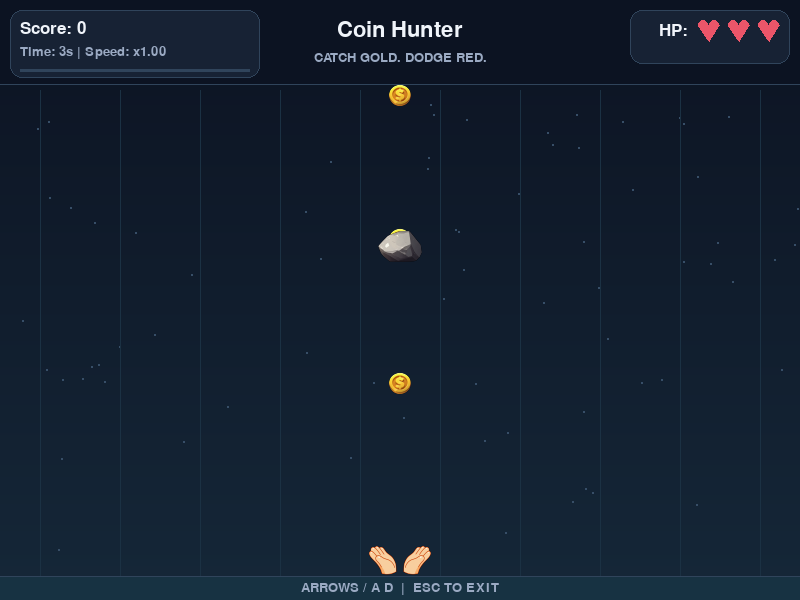

# Coin Hunter

基于 Python + Pygame 的模块化小游戏学习项目。

控制玩家接金币、躲避障碍；支持三点生命值、动态难度、失败重开和透明图片资源。



## 当前进度

- Phase 0：项目结构、配置、资源目录与对象类占位已建立。
- Phase 1：窗口、60 FPS 帧率控制、事件处理、更新接口、绘制与退出清理已实现。
- Phase 2：玩家属性、左右移动、屏幕边界限制、绘制和碰撞区域已实现。
- Phase 3：金币属性、定时随机生成、下落、绘制和离屏清理已实现。
- Phase 4：金币碰撞检测、按价值计分和分数 UI 已实现。
- Phase 5：障碍物属性、定时随机生成、下落、清理和碰撞伤害已实现。
- Phase 6：心形生命值 UI、游戏结束界面和 R / Enter 重新开始已实现。
- Phase 7：有效游戏时间、平滑动态难度、速度同步和难度 UI 已实现。
- Phase 8：默认美术优化、可选图片替换、缓存和加载失败回退已实现。

当前可以接金币获得分数，并躲避下落障碍；碰撞障碍后扣血并短暂变红。
生命值归零后显示 GAME OVER 与最终分数，按 R 或 Enter 可重新开始。
界面使用英文以兼容 Pygame 自带字体，代码注释使用中文。

## 运行（Windows PowerShell）

建议使用 Python 3.10 或更新版本。

```powershell
git clone https://github.com/kdshbjbv/coin-hunter.git
cd coin-hunter
python -m venv .venv
.\.venv\Scripts\python.exe -m pip install -r requirements.txt
.\.venv\Scripts\python.exe main.py
```

如果虚拟环境和依赖已准备好，只需运行最后一条命令，无需激活环境。
在 PyCharm 中选择 `.venv/Scripts/python.exe` 为项目解释器，运行 `main.py`。

macOS / Linux 可使用 `python3 -m venv .venv`，然后通过
`.venv/bin/python -m pip install -r requirements.txt` 安装依赖，
通过 `.venv/bin/python main.py` 启动游戏。

## 模块职责

| 文件 | 职责 |
| --- | --- |
| main.py | 初始化、启动游戏、释放资源 |
| settings.py | 窗口、帧率、颜色、玩家与下落对象参数和资源路径 |
| game_manager.py | 主循环、状态、重开、对象管理、碰撞、HUD 和结束界面 |
| difficulty.py | 按有效游戏时间计算难度曲线与上限 |
| asset_manager.py | 可选图片读取、缩放、缓存和失败回退 |
| utils.py | 文字、心形、面板和默认背景绘制 |
| player.py | 玩家属性、移动、边界、伤害和变色反馈、绘制和碰撞区域 |
| coin.py | 金币属性、下落、绘制、离屏判断和碰撞区域 |
| obstacle.py | 障碍属性、下落、绘制、离屏判断和碰撞区域 |

每帧使用 `clock.tick(FPS)` 控制帧率，并将经过时间转为秒传入 `update(dt)`。
玩家移动采用 `speed * dt`，其中速度单位为像素/秒。
`GameManager` 读取键盘并将方向传入 `Player.update()`，以后可替换为 AI 动作。
玩家保存浮点坐标，`get_rect()` 根据当前位置创建供绘制和碰撞使用的矩形。
金币同样保存浮点位置。默认每 0.8 秒生成一枚，速度为每秒 180 像素，半径为 12 像素，价值为 10。
生成计时器保留余下时间；新金币补上本帧生成后已经经过的时间，减少帧率差异。
金币完全离开窗口底部后会从管理器列表中移除。
玩家与金币使用 `pygame.Rect.colliderect()` 检测矩形重叠，金币使用圆形的外接矩形。
接住金币后立即移除，并按该金币的 `value` 增加分数，默认每枚加 10 分。
同一帧接到多枚金币会分别计分；漏接不扣分，新启动游戏时分数从 0 开始。
障碍物默认为 48 × 36 像素，每 1.8 秒随机生成，速度为每秒 220 像素，伤害为 1。
金币和障碍共用生成计时方法，各自维护列表和计时器。
撞到障碍后按其 `damage` 扣血，移除障碍，玩家变红 0.25 秒；变色期间没有无敌效果。
右上角显示 HP 和三颗心；有生命值的槽位为红色，失去的生命值显示为灰色。
心形通过 Pygame 图形绘制，不依赖 Emoji 字体。
生命值最低为 0，归零后从 PLAYING 切换为 GAME_OVER，玩法停止更新并保留最终分数。
窗口主循环仍运行，因此结束界面能响应 R / Enter 重开、Esc 和关闭按钮。
`reset_game()` 用于首次启动和每次重开，恢复玩家位置、3 点生命值和正常颜色，
清空金币与障碍，重置分数、两种生成计时器及游戏状态；复用原窗口、字体和时钟。
R / Enter 在正常游戏中不重置游戏。

## 动态难度

`game_time` 只累计实际进行中的更新时间，失去焦点和游戏结束时暂停，重开后归零。
`Difficulty.from_game_time()` 是独立的纯计算接口，未来可替换难度曲线。
前 10 秒保持原始难度，之后在 110 秒内平滑提高，120 秒后保持上限：

| 有效时间 | 速度倍率 | 金币速度（像素/秒） | 障碍速度（像素/秒） | 障碍生成间隔（秒） |
| --- | --- | --- | --- | --- |
| 0–10 秒 | 1.00 | 180 | 220 | 1.80 |
| 65 秒 | 1.50 | 270 | 330 | 1.20 |
| 120 秒及以后 | 2.00 | 360 | 440 | 0.60 |

屏幕中已有对象和新生成对象都使用当前难度速度。
缩短障碍生成间隔时，按旧间隔内已经完成的比例换算计时器，避免集中补生成。
金币仍每 0.8 秒生成，玩家速度、金币价值和障碍伤害保持原配置。
左上角分数下方显示有效时间和速度倍率，结束后冻结，重新开始后恢复初始值。

## 基础美术与图片替换

默认画面使用缓存渐变背景、星点、轨道与底部平台，顶部显示分数、难度进度和生命值。
玩家、金币和障碍增加轮廓、高光及细节，操作提示放在底部，暂停与结束使用面板显示。
所有默认美术均由 Pygame 绘制，无需下载资源或安装额外依赖。

将自己的图片放入 `assets/images/`，即可分别替换：

| 文件名 | 显示尺寸 |
| --- | --- |
| player.png | 64 × 32 |
| coin.png | 24 × 24 |
| obstacle.png | 48 × 36 |
| background.png | 800 × 600 |

图片自动缩放，建议保持相同比例；对象图片可使用透明背景。
背景的透明部分显示内置背景，避免拖影；自定义玩家图片受伤时仍会变红并保持透明度。
图片仅替换绘制，不改变已有碰撞尺寸。建议减少对象图片的透明留白。
图片缺失会使用默认图形，损坏或无法读取时记录提示并回退，不中断游戏。
读取和缩放按文件名与显示尺寸缓存，新金币和障碍复用图片。
替换文件后需要关闭并重新启动程序；R / Enter 重开不会刷新资源缓存。
详细说明见 `assets/images/README.md`。

## 手动验收

1. 启动后出现标题为 Coin Hunter 的 800 × 600 窗口。
2. 确认背景、顶部 HUD、玩家和底部操作提示正常，左上角分数为 0，右上角有三颗红心。附带图片显示双手、金币和石头，缺失图片时使用默认图形。
3. 点击游戏窗口使其获得键盘焦点；按住左/右方向键或 A/D，玩家持续左右移动，松开后停止。
4. 持续向两侧移动，玩家完全留在窗口内。
5. 同时按下左右键，玩家停止；同时按下右方向键和 D，速度不会加倍。
6. 等待约 1 秒后出现第一枚金币，随后持续从顶部随机横向位置掉落。
7. 移动到金币下方，接住后金币消失，分数增加 10；继续接金币会累计分数。
8. 故意漏接一枚金币，分数保持不变。
9. 等待约 1.8 秒后看到首个红色矩形障碍，之后持续随机生成并下落。
10. 主动撞一个障碍：障碍消失，玩家短暂变红，一颗心变灰，分数保持不变。
11. 躲开障碍，观察其完全离屏后消失。
12. 切换到其他窗口，玩家、下落对象、生成计时和碰撞一起暂停；切回后继续。
13. 累计撞到三个默认障碍，确认出现 GAME OVER、最终分数和重开提示，场景停止更新。
14. 按 R 重开，确认三颗红心、分数为 0、玩家居中、旧金币和障碍清空。
15. 再次失败后按 Enter 重开，确认金币和障碍按初始间隔重新生成，Time 为 0、Speed 为 x1.00。
16. 正常游戏中按 R / Enter，确认不会重置分数或生命值。
17. 在正常游戏及结束界面分别检查关闭按钮和 Esc。
18. 存活超过 10 秒，确认速度倍率逐渐增加；继续游戏，观察障碍速度与生成频率增加。
19. 切换到其他窗口等待，再切回，确认有效游戏时间与难度没有因等待而增加。
20. 放入指定名称的图片，重新启动，确认对应对象使用图片、位置和碰撞仍正常。
21. 临时移走自己的图片，重新启动，确认默认图形正常恢复。

帧率目标为 60 FPS，实际帧率可能因设备负载而降低。
玩家初始生命值为 3，每个默认障碍造成 1 点伤害。

## 输入法与窗口焦点

Pygame 默认开启文本输入。当前游戏没有文字输入框，因此在创建窗口和重新获得焦点时
调用 `pygame.key.stop_text_input()`，避免中文输入法编辑干扰移动按键。
这只关闭本游戏的文本输入，不修改系统输入法设置。
窗口失去焦点时玩家、金币、障碍及生成计时一起暂停，并显示点击窗口的提示。

回归验收时，请在中文输入法状态下分别测试四个移动键，再切换到其他窗口并切回重测。
自动测试使用模拟按键和焦点，仍需手动确认物理键盘及输入法行为。

## 自动回归检查

在仓库根目录运行：

```powershell
.\.venv\Scripts\python.exe -m unittest discover -s tests -v
```

检查输入法模式、玩家移动、焦点暂停、边界、退出，金币生成、下落、清理和绘制，
以及碰撞计分、分数 UI、障碍生命周期、伤害反馈、心形 UI、结束状态、冻结和完整重开，
动态难度曲线、上限、计时进度换算、速度同步及重开后的难度恢复。
资源测试使用临时 PNG 检查缩放、缓存、透明度、部分替换、加载失败回退和碰撞尺寸。
测试使用无界面驱动，无需打开游戏窗口。
